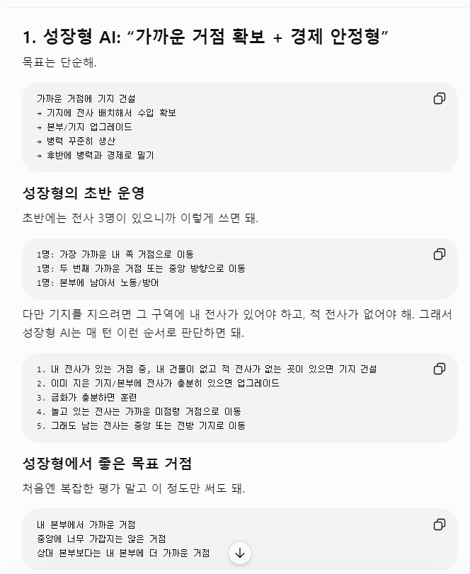

# 2026 NYPC Replay

## Team introduction

- Team name: 자연석수

- Team member: Seoksoo1

- Used LLM: Chatgpt GPT 5.5

## TimeLine

### Start - (2026.06.29)

#### 1. 룰 이해 및 LLM에게 설명

#### 2. Sample Code 구조 분석

#### 3. CLI 툴 및 시뮬레이터 사용법 이해

 사이트에 올라와있는 규칙을 LLM에게 모두 설명한 다음, Sample code를 읽어보았습니다. 첫 코드는 3명의 전사를 모두 적 본진으로 돌진시키도록 되어있었습니다. CLI 툴을 다운로드해서 2개의 AI를 붙여본 다음 시뮬레이터에 생성된 log 파일을 넣어 어떻게 작동하는지 알아보았습니다.

#### 4. 기초 전략 수립 - 유동적

전체적으로 이 게임은 제가 해본 게임 중 **시드 마이어의 문명**과 비슷한 방식으로 흘러간다고 이해했습니다. 적당한 병력 생산 및 기지 업그레이드로 초반을 버텨내고 성장을 노리는 **성장형 전략**과, 초반부터 병력을 많이 생산해 상대가 업그레이드를 하기 전에 승리를 노리는 **공격형 전략** 중 선택이 필요하다고 판단했습니다.

2가지 전략 모두 **맵과 상대의 전략**에 따라서 유불리가 갈릴 수 있습니다.

**성장형** 은 기지 건설이 필수적이기 때문에 본부 가까이에 기지가 있고, 상대가 극초반에 그리 공격적으로 나오지 않을 때 유리합니다.

**공격형** 은 성장형 상대로 초반에 유리할 가능성이 높은 대신 기지가 상대 본부 또는 본부까지 가는 최단 경로에 가까이 있다면 상대의 수비 전략에 막히면 그대로 질 수 밖에 없습니다.

따라서 최종 전략은 **맵과 상대의 초반 5~10턴 움직임에 따라 성장형/공격형을 선택**하는 것이 최적이라고 생각했습니다.

#### 5. 1차 목표 설정 - 기초적 공격형/성장형 AI 만들기

유동적인 전략 선택을 구현하기 전, 간단한 공격형/성장형 전략을 가진 AI를 하나씩 만들어 보는 것이 좋겠다고 생각해 1차 목표를 설정했습니다.

### Defensive Expansion v1 - (2026.06.29 ~ )

#### 1. 구체적인 전략 수립 - LLM 활용

LLM에게 지금까지의 흐름을 설명한 뒤에 약간 더 구체적인 전략을 주문했습니다.

위의 전략을 기초로 LLM의 도움을 받아 첫 번째 공격형 AI를 설계해 보았습니다.

#### 2. Helper functions

구체적인 Decide 함수를 구현하기 전에, 전략 업데이트와 상관없이 앞으로도 사용할 helper function을 몇 개 구현했습니다.

`finding_building`, `count_warriors_at`, `count_my_warriors`, `has_enemy_warrior`는 그 지점에 기지 또는 내/상대 전사가 있는지 확인해서 리턴해줍니다.

`already_moving_to`는 어떤 전사가 목적지가 이미 정해져 있는지 아닌지 리턴해줍니다.

